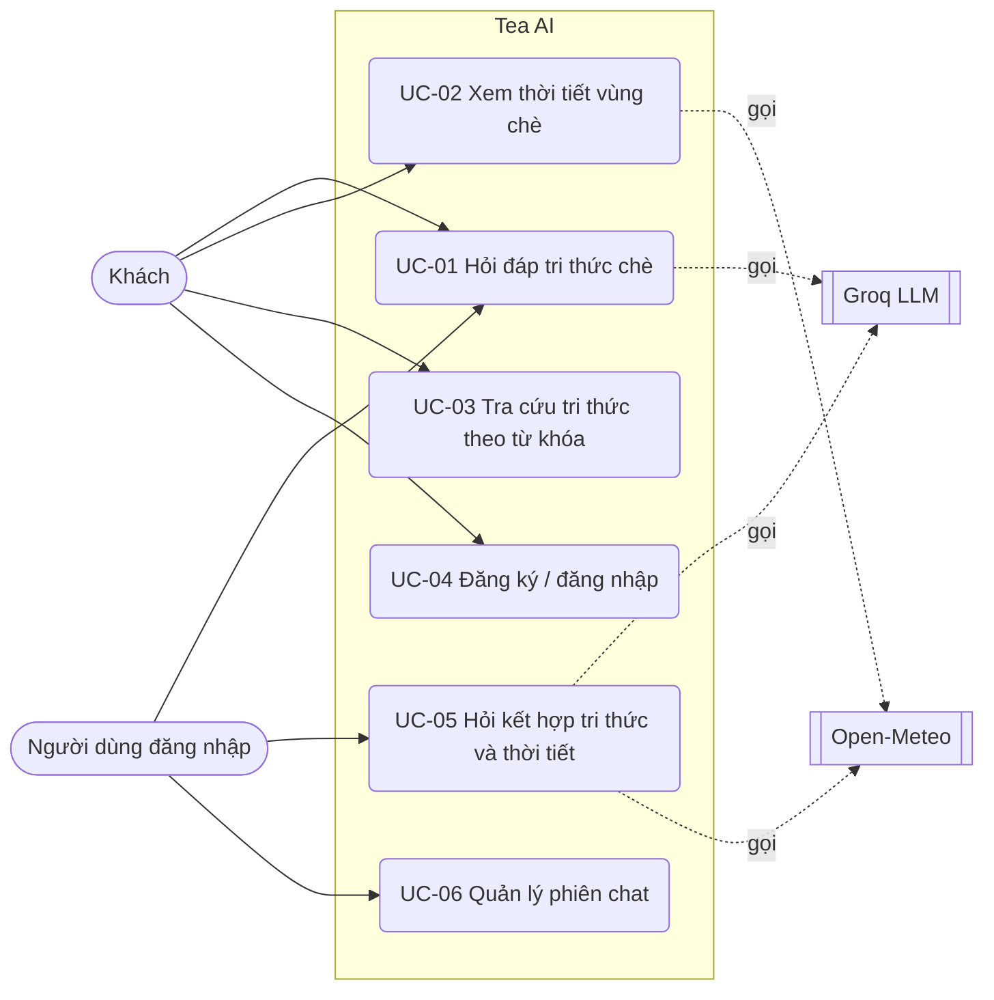

# Phase 1 — Phân tích yêu cầu hệ thống

Tài liệu mô tả yêu cầu của hệ thống **như đã xây dựng**, mỗi yêu cầu gắn với bằng chứng (endpoint, mã nguồn, test) và trạng thái thực hiện. Xem phạm vi và đối tượng ở [00_PROJECT_SCOPE.md](00_PROJECT_SCOPE.md).

Quy ước trạng thái: **Đạt** (đã cài đặt và có test), **Một phần** (có nhưng giới hạn), **Không** (ngoài phạm vi hoặc chưa làm). Độ ưu tiên: **M** (bắt buộc), **S** (nên có), **C** (có thể có).

## 1. Tác nhân

| Tác nhân | Mô tả |
|---|---|
| Khách (chưa đăng nhập) | Hỏi đáp, tra cứu, xem thời tiết; phiên chat không gắn với tài khoản |
| Người dùng đã đăng nhập | Như khách, phiên chat gắn với tài khoản và được bảo vệ quyền sở hữu |
| Quản trị viên | Vai trò `admin` tồn tại trong mô hình dữ liệu; hiện chưa có chức năng riêng cho admin ngoài script |
| Groq (hệ thống ngoài) | Sinh câu trả lời |
| Open-Meteo (hệ thống ngoài) | Cung cấp thời tiết hiện tại |

## 2. Sơ đồ ca sử dụng

## 3. Mô tả ca sử dụng chính

### UC-01 — Hỏi đáp tri thức chè

- **Tiền điều kiện:** hệ thống đã lập chỉ mục RAG; khóa Groq đã cấu hình.
- **Luồng chính:** (1) Người dùng nhập câu hỏi. (2) Hệ thống xác định phiên (tạo mới nếu chưa có). (3) Phân loại ý định là tri thức. (4) Truy xuất top-3 chunk. (5) Chunk đạt cổng liên quan thì chuyển cho LLM cùng lịch sử hội thoại. (6) Trả câu trả lời kèm nguồn trích dẫn; lưu vào phiên.
- **Luồng thay thế:**
  - 4a. Không chunk nào đạt cổng liên quan: trả câu "chưa tìm thấy nguồn thông tin đủ phù hợp", **không gọi LLM, không hiển thị nguồn**.
  - 2a. Phiên thuộc người khác: HTTP 403. Phiên không tồn tại: HTTP 404.
  - 5a. Groq lỗi/quá tải/quá thời gian: HTTP 502/503/504 với thông báo rõ.
  - 4b. Chỉ mục RAG chưa tạo hoặc cũ: HTTP 503 kèm lệnh cần chạy.
- **Hậu điều kiện:** cặp tin nhắn người dùng/trợ lý được lưu; tiêu đề phiên là 40 ký tự đầu của câu hỏi đầu tiên.

### UC-02 — Xem thời tiết vùng chè

- **Luồng chính:** chọn vùng trong danh sách → hệ thống tra tọa độ → gọi Open-Meteo → chuẩn hóa (nhiệt độ, độ ẩm, lượng mưa, tốc độ gió m/s, mô tả thời tiết tiếng Việt) → lưu/cập nhật bảng `weather_data` → hiển thị.
- **Ngoại lệ:** vùng chưa có tọa độ → 404; nhà cung cấp lỗi → 502; quá thời gian → 504.

### UC-03 — Tra cứu tri thức theo từ khóa

- Người dùng nhập từ khóa; hệ thống tìm trong các chunk và trả danh sách phân trang gồm tiêu đề, nội dung, nguồn, trang, danh mục, năm. Không có kết quả thì hiển thị trạng thái rỗng.

### UC-04 — Đăng ký / đăng nhập

- Đăng ký bằng tên đăng nhập (3–50 ký tự), email hợp lệ, mật khẩu (tối thiểu 6 ký tự). Trùng tên hoặc email: HTTP 409. Đăng nhập bằng tên hoặc email, nhận JWT hiệu lực 24 giờ; sai thông tin: 401; tài khoản bị khóa: 403.

### UC-05 — Hỏi kết hợp tri thức và thời tiết

- Ví dụ: "Thời tiết Thái Nguyên hiện tại có thuận lợi cho bệnh thối búp không?" Hệ thống truy xuất tri thức về bệnh **và** lấy thời tiết Thái Nguyên, đưa cả hai ngữ cảnh cho LLM. Nếu tri thức không phù hợp thì chỉ dùng ngữ cảnh thời tiết, không đưa chunk lạc đề vào LLM. Nếu thời tiết lỗi, câu trả lời vẫn được sinh với ghi chú lỗi thời tiết.

### UC-06 — Quản lý phiên chat

- Tạo, xem, xóa phiên và thêm tin nhắn qua API; chỉ chủ sở hữu được thao tác trên phiên có chủ. Người chưa đăng nhập không liệt kê được phiên.

## 4. Yêu cầu chức năng

| ID | Yêu cầu | Ưu tiên | Trạng thái | Bằng chứng |
|---|---|---|---|---|
| FR-01 | Đăng ký tài khoản, chặn trùng tên/email | M | Đạt | `POST /api/v1/auth/register`; `test_backend.py::test_auth_and_chat_flow` |
| FR-02 | Đăng nhập bằng tên hoặc email, cấp JWT | M | Đạt | `POST /api/v1/auth/login` |
| FR-03 | Xem thông tin tài khoản hiện tại | S | Đạt | `GET /api/v1/auth/me`; giao diện tự khôi phục phiên đăng nhập |
| FR-04 | Hỏi đáp bằng ngôn ngữ tự nhiên, trả lời kèm nguồn | M | Đạt | `POST /api/v1/chat/query`; `test_assistant.py`, `test_chat_rag.py` |
| FR-05 | Hội thoại nhiều lượt trong một phiên (tối đa 5 lượt lịch sử, 500 ký tự mỗi lượt) | M | Đạt | `test_chat_rag.py` (multi-turn, history truncation) |
| FR-06 | Hiểu câu hỏi nối tiếp có đại từ ("nó", "đó") | S | Đạt | `intent_classifier.build_retrieval_query`; `test_assistant_flows.py` |
| FR-07 | Trả nguồn trích dẫn (mã chunk, tiêu đề, nguồn, độ tương đồng) | M | Đạt | Trường `sources` của `ChatQueryResponse` |
| FR-08 | Từ chối khi cơ sở tri thức không có thông tin phù hợp, không gọi LLM | M | Đạt | `rag/retriever.py` (cổng liên quan); `test_assistant.py`, `test_session_security.py` |
| FR-09 | Thời tiết trực tiếp cho 12 vùng chè | M | Đạt | `GET /api/v1/weather/live`; `test_weather_integration.py` |
| FR-10 | Câu hỏi lai (tri thức + thời tiết) | S | Đạt | `assistant_service`; `test_assistant.py`, `test_assistant_flows.py` |
| FR-11 | Trả lời lời chào/cảm ơn/tạm biệt mà không gọi LLM | C | Đạt | `test_assistant_flows.py` |
| FR-12 | Tra cứu tri thức theo từ khóa, có phân trang | M | Đạt | `GET /api/v1/knowledge/search`; `test_backend.py` |
| FR-13 | Duyệt dữ liệu tri thức, bệnh hại, chủ đề canh tác, tài liệu nguồn (chỉ đọc) | S | Đạt | `/api/v1/knowledge`, `/diseases`, `/cultivation`, `/documents`; `test_backend.py` |
| FR-14 | Quản lý phiên chat và tin nhắn, bảo vệ quyền sở hữu | M | Đạt (API) | `/api/v1/chat/sessions*`; `test_session_security.py` |
| FR-15 | Giao diện hiển thị lịch sử các phiên chat (mở lại, xóa) cho người đã đăng nhập | S | Đạt | Panel "Lịch sử" trong trang Trợ lý (`routes/assistant.tsx`); đã kiểm tra biên dịch và lint, chưa có test giao diện tự động |
| FR-16 | Chẩn đoán bệnh qua ảnh lá chè | C | Không | Ngoài phạm vi; nút giao diện bị vô hiệu hóa |
| FR-17 | Dự báo thời tiết nhiều ngày | C | Không | Ngoài phạm vi |
| FR-18 | Quản trị tri thức qua giao diện | C | Không | Thực hiện qua script |
| FR-19 | Trang Cài đặt (giao diện, độ chi tiết câu trả lời) | C | Một phần | Chỉ lưu trạng thái cục bộ trên trang, chưa tác động tới hệ thống |
| FR-21 | Gợi ý từ khóa khi gõ trong ô tìm kiếm (không phân biệt dấu) và lịch sử tìm kiếm trên trình duyệt | C | Đạt | `GET /api/v1/knowledge/suggest`; `components/common/search-suggest-box.tsx`; test `test_suggest_*` trong `test_backend.py` |
| FR-20 | Kiểm tra tình trạng dịch vụ | S | Đạt | `GET /api/v1/health`; `test_backend.py::test_health_endpoints` |

## 5. Yêu cầu phi chức năng

| ID | Nhóm | Yêu cầu | Trạng thái | Bằng chứng / ghi chú |
|---|---|---|---|---|
| NFR-01 | Bảo mật | Mật khẩu lưu dạng băm bcrypt | Đạt | `auth_service.py` |
| NFR-02 | Bảo mật | Xác thực bằng JWT (HS256), hết hạn 24 giờ; khóa bí mật bắt buộc ở môi trường production | Đạt | `backend/config.py` |
| NFR-03 | Bảo mật | Phiên chat có chủ chỉ chủ sở hữu truy cập; không liệt kê phiên cho khách | Đạt | `test_session_security.py` |
| NFR-04 | Bảo mật | CORS giới hạn theo danh sách origin cấu hình được | Đạt | `CORS_ORIGINS` |
| NFR-05 | Bảo mật | Giới hạn độ dài câu hỏi 2000 ký tự | Đạt | `ChatQueryRequest`; test trong `test_session_security.py` |
| NFR-06 | Bảo mật | Bí mật (khóa API, JWT) không nằm trong mã nguồn; `.env` bị loại khỏi kiểm soát phiên bản | Đạt | `.gitignore`, `.env.example` |
| NFR-07 | Độ chính xác | Truy xuất đúng chunk: Hit@3 ≥ 0.90 trên bộ đánh giá | Đạt (0.98) | `docs/RAG_EVALUATION.md`; test hồi quy `rag/tests/test_rag.py` |
| NFR-08 | Độ chính xác | Từ chối câu ngoài cơ sở tri thức | Một phần (58% câu ngoài phạm vi bị từ chối ở tầng truy xuất, phần còn lại dựa vào prompt ràng buộc của LLM) | `docs/RAG_EVALUATION.md` mục 4 |
| NFR-09 | Độ tin cậy | Lỗi dịch vụ ngoài trả mã HTTP phân biệt (502/503/504) và thông báo rõ | Đạt | `llm_service.py`, `external_weather_service.py`; test 3–5 của weather |
| NFR-10 | Hiệu năng | Không nạp lại mô hình embedding ở mỗi câu hỏi | Đạt | Retriever dùng chung, nạp khi khởi động; `test_default_retriever_is_shared_instance` |
| NFR-11 | Hiệu năng | Độ trễ phản hồi mục tiêu | **Chưa đo** | Chưa có số đo độ trễ; phụ thuộc Groq và Open-Meteo. Cần đo trước khi cam kết con số |
| NFR-12 | Khả dụng | Giao diện responsive (máy tính, máy tính bảng, điện thoại), tiếng Việt, có trạng thái đang tải/lỗi/rỗng | Đạt | Frontend; báo cáo Phase 10 |
| NFR-13 | Khả chuyển | Chạy với SQLite (phát triển) và PostgreSQL (triển khai) | Một phần | SQLite đã kiểm thử; PostgreSQL cấu hình qua `DATABASE_URL` **chưa được chạy thử** |
| NFR-14 | Bảo trì | Có bộ test tự động, tách DB test khỏi dữ liệu thật | Đạt | 91 test (`backend/tests`, `rag/tests`) |
| NFR-15 | Bảo trì | Cấu hình qua biến môi trường; có README, `requirements.txt` | Đạt | `.env.example`, `README.md` |
| NFR-17 | Độ chính xác | Câu trả lời bám tài liệu, không bịa số liệu | Một phần | `docs/ANSWER_EVALUATION.md`: độ bám nguồn 0,96–0,98 theo model chấm khắt khe, 0 câu trả lời nhầm câu ngoài phạm vi; mẫu nhỏ, chưa chấm tay |
| NFR-16 | Kiểm chứng được | Có quy trình đo chất lượng RAG có thể chạy lại | Đạt | `python -m rag.evaluation.run_eval` |

## 6. Yêu cầu dữ liệu

| Dữ liệu | Yêu cầu | Hiện trạng |
|---|---|---|
| Chunk tri thức | Mã duy nhất, nội dung, nguồn, loại nguồn, danh mục, trang/năm nếu có; chunk nguồn ngoài phải có giấy phép, URL, trích nguyên văn | 171 chunk (`tea_000001`–`tea_000171`); nhãn `category` sai ở ít nhất 23 chunk gốc |
| Tài liệu nguồn | Mã, tiêu đề, nguồn, phiên bản, vùng, năm | 3 tài liệu |
| Người dùng | Tên, email duy nhất, mật khẩu băm, vai trò, trạng thái | Bảng `users` |
| Hội thoại | Phiên gắn người dùng (có thể rỗng), tin nhắn có nguồn trích dẫn dạng JSON | `chat_sessions`, `chat_messages` |
| Thời tiết | Vùng, tọa độ, nhiệt độ, độ ẩm, lượng mưa, tốc độ gió (m/s), mô tả, thời điểm đo | `weather_data` (mỗi vùng một bản ghi được cập nhật) |

Chi tiết lược đồ: [DATABASE_SCHEMA.md](DATABASE_SCHEMA.md).

## 7. Giao diện API chính

| Nhóm | Endpoint | Xác thực |
|---|---|---|
| Xác thực | `POST /api/v1/auth/register`, `POST /api/v1/auth/login`, `GET /api/v1/auth/me` | `me` cần token |
| Chat | `POST /api/v1/chat/query` | Tùy chọn (khách được phép) |
| Phiên chat | `GET/POST /api/v1/chat/sessions`, `GET/DELETE /api/v1/chat/sessions/{id}`, `GET/POST /api/v1/chat/sessions/{id}/messages` | Tùy chọn; phiên có chủ yêu cầu đúng chủ |
| Tri thức | `GET /api/v1/knowledge`, `/knowledge/search`, `/knowledge/suggest`, `/knowledge/{chunk_id}` | Không |
| Dữ liệu tham chiếu | `GET /api/v1/diseases`, `/diseases/search`, `/cultivation`, `/documents` (và `/{id}`) | Không |
| Thời tiết | `GET /api/v1/weather`, `/weather/live?region=`, `/weather/{id}` | Không |
| Hệ thống | `GET /`, `GET /api/v1/health` | Không |

Tài liệu tương tác đầy đủ tại `/docs` (OpenAPI).

## 8. Tiêu chí nghiệm thu

| # | Tiêu chí | Cách kiểm tra | Kết quả |
|---|---|---|---|
| A1 | Toàn bộ test tự động đạt | `python -m pytest backend/tests rag/tests -q` | 91/91 đạt |
| A2 | Câu hỏi trong cơ sở tri thức được trả lời kèm nguồn đúng chủ đề | `test_1_knowledge_query`; bộ đánh giá RAG | Đạt |
| A3 | Câu hỏi không có trong cơ sở tri thức bị từ chối, không hiển thị nguồn | `test_7_low_similarity_fallback`, `test_fallback_answer_returns_no_sources` | Đạt |
| A4 | Người dùng khác không truy cập được phiên chat của chủ | `test_other_user_cannot_access_session` | Đạt |
| A5 | Thời tiết trực tiếp hiển thị và đổi theo vùng | `test_weather_integration.py`; kiểm tra thủ công trên giao diện | Đạt (kiểm thử tự động); giao diện cần thử lại thủ công với Groq và Open-Meteo thật |
| A6 | Frontend biên dịch, kiểm tra kiểu và lint sạch | `npx tsc --noEmit`, `npx eslint src`, `npm run build` | Đạt |

## 9. Ma trận truy vết (mục tiêu → yêu cầu → kiểm chứng)

| Mục tiêu | Yêu cầu | Kiểm chứng |
|---|---|---|
| G1 Cơ sở tri thức | FR-12, FR-13, dữ liệu | `test_knowledge_base_integrity_with_json`, `database/verify_database.py` |
| G2 Truy xuất đúng | NFR-07 | `rag/tests/test_rag.py`, `run_eval` |
| G3 Trích dẫn và từ chối | FR-04, FR-07, FR-08, NFR-08 | `test_assistant.py`, `test_assistant_flows.py`, `test_session_security.py` |
| G4 Thời tiết | FR-09, FR-10 | `test_weather_integration.py`, `test_assistant.py` |
| G5 Tài khoản và lịch sử | FR-01–03, FR-14, NFR-01–03 | `test_backend.py`, `test_session_security.py` |
| G6 Giao diện | FR-15, NFR-12 | Báo cáo Phase 10, build frontend |

## 10. Các khoảng trống đã biết so với yêu cầu

1. NFR-11: chưa đo độ trễ.
2. NFR-13: chưa chạy thử PostgreSQL.
3. NFR-08: cổng từ chối ở tầng truy xuất chưa lọc hết câu ngoài phạm vi; chưa có kiểm tra tự động đầu-cuối với Groq thật.
4. Tài khoản `admin` do `database/seed.py` tạo có mật khẩu băm giả, không đăng nhập được.
