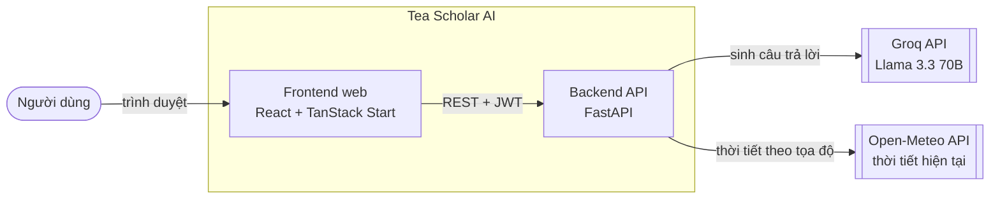
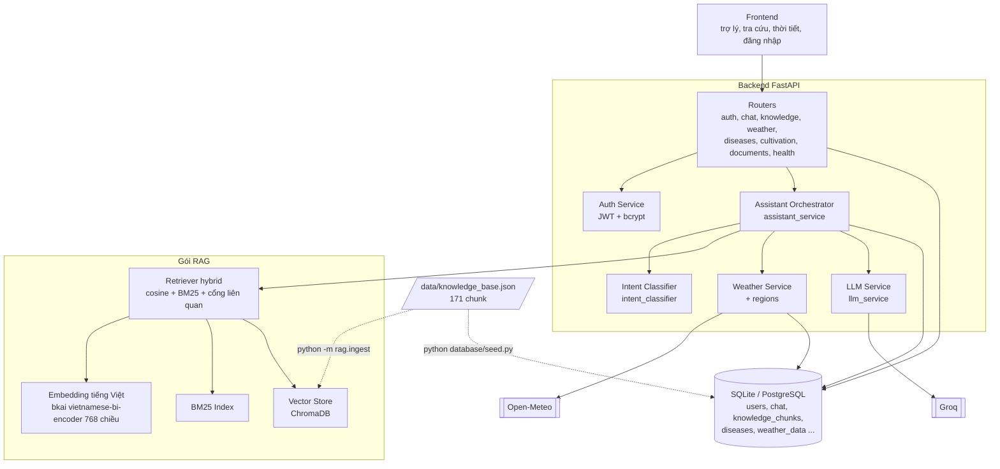
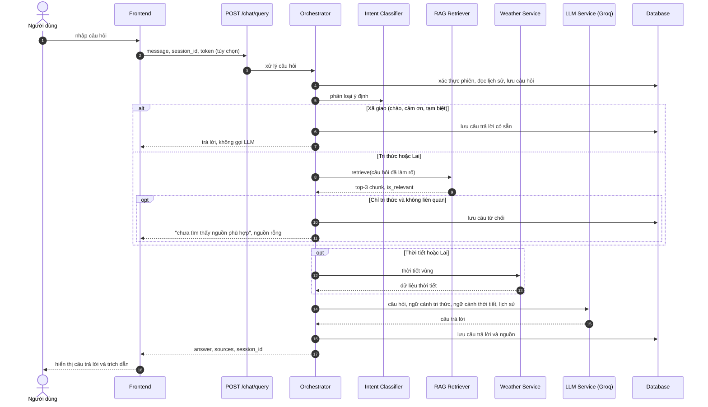
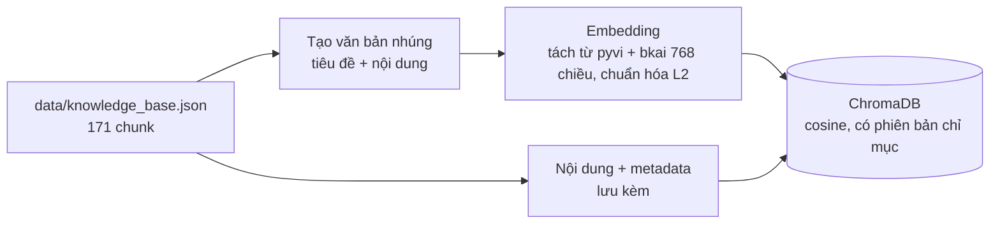
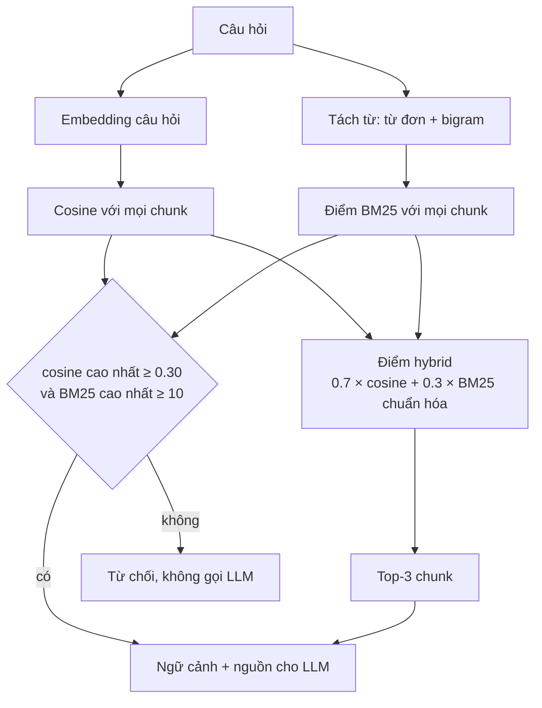
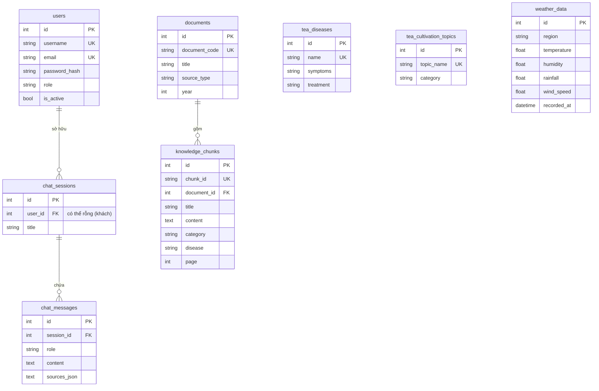
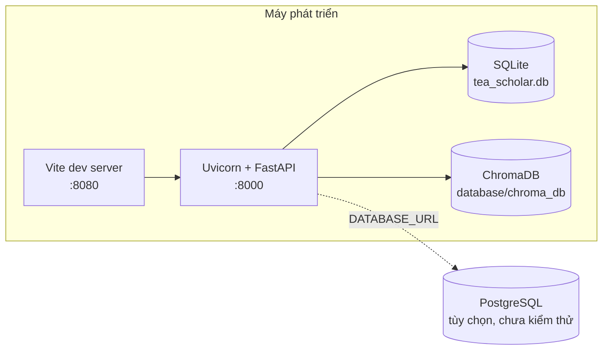

# Phase 2 — Thiết kế kiến trúc

Tài liệu mô tả kiến trúc **như đã xây dựng**. Các sơ đồ dùng Mermaid (hiển thị trực tiếp trên GitHub, VS Code có tiện ích Mermaid; có thể xuất ra ảnh bằng https://mermaid.live để đưa vào báo cáo).

## 1. Bối cảnh hệ thống

## 2. Kiến trúc thành phần

### Phân tầng mã nguồn

| Tầng | Thư mục | Trách nhiệm |
|---|---|---|
| Giao diện | `frontend/src` | Trang, gọi API qua `lib/api-client.ts`, quản lý trạng thái đăng nhập (`context/auth-context.tsx`) |
| API | `backend/routers` | Định tuyến, xác thực đầu vào (schema Pydantic), phân quyền |
| Nghiệp vụ | `backend/services` | Điều phối trợ lý, phân loại ý định, thời tiết, LLM, xác thực |
| RAG | `rag/` | Embedding, BM25, lưu trữ vector, truy xuất, đánh giá |
| Dữ liệu | `database/` | Mô hình SQLAlchemy, seed, kiểm tra |

Nguyên tắc: router không chứa logic nghiệp vụ; service không biết HTTP ngoại trừ ném `HTTPException` mang mã lỗi; gói `rag/` độc lập với backend (không import `backend`), nên có thể kiểm thử và đánh giá riêng.

## 3. Luồng xử lý một câu hỏi

### Quy tắc phân loại ý định (`intent_classifier.py`)

| Ý định | Điều kiện |
|---|---|
| `WEATHER_QUERY` | Từ khóa thời tiết trong câu hỏi, hoặc nêu vùng khi hội thoại trước đó nói về thời tiết |
| `HYBRID_QUERY` | Có cả tín hiệu thời tiết và từ khóa tri thức |
| `GENERAL_CHAT` | Lời chào/cảm ơn/tạm biệt (khớp theo ranh giới từ) và không có từ khóa tri thức |
| `KNOWLEDGE_QUERY` | Mọi trường hợp còn lại |

Phân loại bằng luật nên nhanh, xác định, không tốn lượt gọi LLM và dễ kiểm thử. Đổi lại độ phủ hạn chế theo từ khóa (xem mục 9).

## 4. Pipeline RAG

### Lập chỉ mục (ngoại tuyến)

Lệnh: `python -m rag.ingest`. Mỗi lần chạy xóa và tạo lại collection để không sót chunk cũ; chỉ mục mang `index_version`, retriever từ chối chỉ mục sai phiên.

### Truy xuất (trực tuyến)

Lý do chọn và số liệu đo: [RAG_EVALUATION.md](RAG_EVALUATION.md). Đối chiếu với project tham khảo: [RAG_AUDIT.md](RAG_AUDIT.md).

## 5. Mô hình dữ liệu

Chi tiết cột và chỉ mục: [DATABASE_SCHEMA.md](DATABASE_SCHEMA.md). Vector embedding **không** nằm trong bảng quan hệ mà ở ChromaDB (`database/chroma_db/`), liên kết với dữ liệu quan hệ qua `chunk_id`.

## 6. Triển khai

Backend và frontend chạy trực tiếp trên máy (xem `README.md`). PostgreSQL chỉ cần đặt `DATABASE_URL`, chưa được chạy thử.

## 7. Quyết định thiết kế

| Quyết định | Lựa chọn | Lý do | Đánh đổi |
|---|---|---|---|
| Kiến trúc RAG | Truy xuất hybrid (cosine + BM25) tự cài đặt | Đo được: MRR 0.96 so với 0.64 của cosine thuần; thuật ngữ chuyên môn được BM25 nắm tốt | Nạp toàn bộ embedding vào bộ nhớ, phù hợp tới cỡ vài chục nghìn chunk |
| Embedding | `bkai-foundation-models/vietnamese-bi-encoder` (PhoBERT, Apache-2.0) chạy cục bộ, kèm tách từ `pyvi` | Chuyên tiếng Việt; trên bộ đánh giá của dự án cho cổng từ chối câu ngoài phạm vi tốt hơn hẳn model đa ngữ MiniLM ban đầu (100% so với 58%) | Model lớn hơn (773 MB), khởi động lâu hơn (khoảng 30 giây), phụ thuộc thêm `pyvi`; độ dài đầu vào tối đa 256 token |
| Vector store | ChromaDB (lưu bền vững) | Cài đặt đơn giản, không cần máy chủ riêng | Tách khỏi CSDL quan hệ; pgvector là hướng gom một hệ thống về sau |
| Cơ sở dữ liệu | SQLAlchemy 2.0; SQLite phát triển, PostgreSQL triển khai | Cùng mã nguồn cho hai môi trường | Chưa có migration (Alembic); tạo bảng bằng `create_all` |
| LLM | Groq (mặc định `openai/gpt-oss-120b`) qua client tương thích OpenAI | Tốc độ suy luận cao, chi phí thấp; dễ đổi nhà cung cấp nhờ giao diện OpenAI | Phụ thuộc dịch vụ ngoài và giới hạn tần suất; danh sách model có thể đổi (model Llama 3.3 ban đầu đã bị ngừng, buộc chuyển sang gpt-oss-120b) |
| Chống bịa thông tin | Cổng liên quan trước LLM + prompt chỉ trả lời theo ngữ cảnh + hiển thị nguồn | Hai lớp phòng thủ, lớp đầu không tốn lượt gọi LLM | Cổng chưa lọc hết câu ngoài phạm vi |
| Phân loại ý định | Luật từ khóa | Nhanh, xác định, dễ kiểm thử, không thêm lượt gọi LLM | Độ phủ hạn chế, cần bảo trì từ khóa |
| Xác thực | JWT (HS256) + bcrypt | Không trạng thái phía máy chủ, phù hợp API cho SPA | Chưa có làm mới token hay thu hồi token |
| Khách vãng lai | Cho phép hỏi đáp không đăng nhập | Giảm rào cản dùng thử | Phiên ẩn danh không có bảo vệ chủ sở hữu (giới hạn MVP) |
| Frontend | TanStack Start + React 19 + Tailwind + shadcn/ui | Định tuyến theo tệp, kiểu an toàn với TypeScript, bộ thành phần sẵn | Khung sinh từ công cụ Lovable, còn một số tệp hạ tầng không thuộc đề tài (`lib/error`) |

## 8. Bảo mật và xử lý lỗi

**Bảo mật**

- Mật khẩu băm bcrypt; JWT ký bằng `SECRET_KEY`, ở môi trường production khóa này là bắt buộc (`APP_ENV=production`).
- Phiên chat có chủ chỉ cho phép đúng chủ (HTTP 403 nếu khác); khách không liệt kê được phiên; phiên không tồn tại trả 404.
- CORS theo danh sách origin cấu hình; câu hỏi giới hạn 2000 ký tự; bí mật lấy từ biến môi trường, `.env` không đưa vào kiểm soát phiên bản.
- Câu trả lời từ LLM được hiển thị qua thành phần Markdown của frontend; chưa có kiểm duyệt nội dung đầu ra ngoài prompt ràng buộc.

**Xử lý lỗi**

| Mã | Tình huống |
|---|---|
| 400 | Nội dung câu hỏi rỗng; thiếu tham số vùng |
| 401 | Token thiếu/hết hạn; sai thông tin đăng nhập |
| 403 | Truy cập phiên chat của người khác; tài khoản bị khóa |
| 404 | Phiên hoặc bản ghi không tồn tại; vùng chưa có tọa độ |
| 409 | Trùng tên đăng nhập hoặc email |
| 422 | Dữ liệu vào sai định dạng (ví dụ câu hỏi quá dài) |
| 502 | Groq hoặc Open-Meteo trả lỗi |
| 503 | Thiếu khóa Groq, Groq quá tải, chỉ mục RAG chưa sẵn sàng |
| 504 | Groq hoặc Open-Meteo quá thời gian |
| 500 | Lỗi không lường trước (ghi log kèm traceback, trả thông báo chung) |

## 9. Hạn chế và hướng mở rộng

| Hạn chế | Ảnh hưởng | Hướng xử lý |
|---|---|---|
| Phân loại ý định theo từ khóa | Câu hỏi về thời tiết dùng từ lạ có thể bị xếp vào tri thức | Mở rộng từ khóa, hoặc dùng LLM/mô hình phân loại nếu bộ đánh giá chỉ ra cần |
| Cổng liên quan lọc 58% câu ngoài phạm vi | Một số câu ngoài chủ đề vẫn tới LLM | Bổ sung dữ liệu, tập kiểm tra độc lập, kiểm thử tự động câu trả lời LLM |
| Chưa có migration | Đổi lược đồ phải xử lý thủ công | Thêm Alembic |
| Embedding trong bộ nhớ | Không mở rộng tới hàng trăm nghìn chunk | pgvector hoặc chỉ mục xấp xỉ |
| Chưa đo độ trễ | Chưa có cam kết hiệu năng | Đo và ghi nhận thời gian phản hồi từng tầng |
| Thời tiết chỉ hiện tại | Không tư vấn theo dự báo | Dùng tham số dự báo của Open-Meteo |
